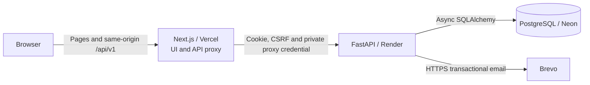

<div align="center">

# CampusCollab

### Student Project Discovery & Team Formation Platform

Find a project, apply for a contribution role, and build a team with other university students.<br/>
CampusCollab connects project discovery with recruitment, application review, and team membership.

<p>
  
  
  
  
  
  
</p>

**[Open CampusCollab](https://campus-collab-beryl.vercel.app)** <br>
· **[API readiness](https://campuscollab-api.onrender.com/health/ready)**  <br>
· **[Repository](https://github.com/Chaitanya7777777/CampusCollab)**

</div>

Students often have project ideas but lack a clear way to find collaborators with complementary skills. CampusCollab makes the next steps explicit: describe the work, recruit for specific contributions, review applications, and form a team.

**Create a profile → publish a project → discover → apply → owner reviews → join the team.**

The live app uses free hosting. An idle backend can take time to wake up; if the first request times out, wait and retry. Before repeating a mutation, check whether it succeeded. Browser API requests pass through the frontend's same-origin proxy. The readiness link reports backend/database health, not an interactive application or a complete workflow check.

## Features

| Area | Implemented capabilities |
| --- | --- |
| **Authentication & profiles** | Six-digit email-code signup creates an account only after confirmation. Email/password login, logout, password recovery, editable student profiles, and selected skills. |
| **Discovery & publishing** | Server-side search, filters, sorting, and pagination. Create projects, save and edit drafts, define contribution roles and required skills, then publish. Supports hackathons, personal projects, research, startups, and open source. |
| **Applications & owner review** | Role-specific applications; searchable, filterable application history and owner inboxes; private review dialogs; acceptance, rejection, and applicant withdrawal. Owner dashboards include recruitment controls and archiving. |
| **Team formation** | Acceptance creates membership atomically. Team size includes the owner; team counts and remaining role openings come from memberships. My Projects separates owned and joined projects. |
| **Shared skill catalog** | Search or explicitly add a skill from profile and project-role editors. New skills become available to everyone; discarding a form or removing a selection does not delete the catalog entry. Creation requires a verified account. |

Skill matching normalizes Unicode, trims and collapses whitespace, and uses casefolding for uniqueness. `Python`, `python`, and ` Python ` resolve to one record, while `C`, `C++`, and `C#` stay distinct. Display spelling is preserved; aliases such as `React` and `React.js` are not automatically merged. See the [shared-skills contract](backend/SKILLS.md).

## Architecture



PostgreSQL persists accounts, sessions, profiles, projects, applications, and memberships. TanStack Query caches server data in the frontend; it is not the source of truth. Mock mode uses separate local prototype data.

The production proxy forwards permitted routes to one configured backend and preserves session cookies and CSRF headers. Its private credential authenticates the forwarding boundary and client-IP attribution. **User identity and permissions still come from the database-backed session.**

## Technology stack

| Layer | Technology and purpose |
| --- | --- |
| Frontend | Next.js App Router, React, TypeScript, Tailwind CSS, Radix UI primitives |
| Forms & server state | React Hook Form, Zod, TanStack Query |
| Backend | FastAPI, Pydantic settings/schemas, async SQLAlchemy, asyncpg |
| Persistence | PostgreSQL with Alembic migrations |
| Authentication | Argon2 password hashes, opaque cookie sessions, CSRF protection, PostgreSQL-backed rate limits |
| Email | Brevo HTTPS transactional API; SMTP/Mailpit for local development and browser tests |
| Testing | Pytest, HTTPX, Vitest, Playwright; Ruff, ESLint, TypeScript checks |
| Local infrastructure | Docker Compose: PostgreSQL, isolated test PostgreSQL, Mailpit |
| Hosting | Vercel Hobby frontend; Render Free backend and Neon PostgreSQL in Singapore |

CampusCollab implements its own session authentication; it does not use Supabase Auth or JWT login. Dependency versions are recorded in the frontend npm lockfile and backend pinned requirements.

## Engineering decisions

| Challenge | Implementation |
| --- | --- |
| Concurrent acceptance into the last place | Lock the project before the application, recheck ownership/status and both capacities, then commit membership and application status together. Pending applications do not reserve places. |
| Duplicate skill creation | A database unique normalized-name key and transactional create-or-get resolve concurrent equivalent submissions to the same ID. Opaque generated IDs avoid punctuation-based slug collisions. |
| Cross-host cookie authentication | A fixed-target, same-origin Next.js proxy preserves multiple `Set-Cookie` headers, rejects upstream redirects, and disables response caching. CSRF and Origin checks remain enforced. |
| Session and account isolation | Restore identity from the backend, isolate private query state, and clear it on account changes or expiry. API failures never substitute a mock account. |
| Tab-switch scroll and form stability | Same-account session revalidation keeps existing content mounted, then refreshes queries in the background. Initial loading remains separate from background fetching. |
| Safe schema and administrative changes | Alembic migrations run under an advisory lock before production startup. Skill normalization preserves references and fails on collisions. Explicit imports use previews, stable IDs, transactions, and conflict checks without overwriting unrelated records. |

## Security boundaries

- Passwords use Argon2 hashing. Only hashes of random session tokens are stored; production cookies are host-only, Secure, and HttpOnly.
- Signup stores a pending registration with a password hash and registration-bound HMAC code digest. Confirmation creates the verified account, profile, and session atomically. Login remains email/password.
- Recovery tokens are expiring, single-use, and stored as hashes. Resetting a password revokes all sessions. Public recovery responses do not disclose whether an account exists.
- Unsafe requests require a CSRF token and allowed Origin. PostgreSQL rate limits cover authentication and skill creation; production forwarding uses a private proxy credential rather than trusting arbitrary client headers.
- Backend authorization protects profiles and applicant content. Applicants see their own records; owners review only their projects' inboxes. One application per student/project is enforced across all statuses.

Email verification is required to publish, apply, or create a shared skill; it does not certify a college affiliation or skill. These controls do not replace operational monitoring, abuse handling, or security review. Detailed contracts are in the [authentication guide](backend/AUTHENTICATION.md) and [signup-code guide](backend/SIGNUP_CODES.md).

## Local development

Use **Node.js 24.x**, **Python 3.12+** (the deployment pins 3.14.6), Git, and Docker with Compose v2. On Windows, run Docker Desktop with Linux containers. These commands use PowerShell; [backend setup](backend/README.md#local-setup) and [frontend setup](frontend/API_MODE.md#local-startup) include POSIX equivalents.

### 1. Clone and start local services

```powershell
git clone https://github.com/Chaitanya7777777/CampusCollab.git
cd CampusCollab
docker compose up -d --wait postgres mailpit
```

Development PostgreSQL binds to localhost port **5432** and persists in a named volume. Mailpit captures local messages at **[localhost:8025](http://localhost:8025)**; it does not deliver them to Gmail or other external inboxes.

### 2. Prepare the backend

```powershell
if (-not (Test-Path backend/.venv)) { python -m venv backend/.venv }
backend/.venv/Scripts/python.exe -m pip install -r backend/requirements.txt
if (-not (Test-Path backend/.env)) { Copy-Item backend/.env.example backend/.env }
```

Generate the local CSRF secret without printing it. This replaces only the example placeholder and preserves other settings:

```powershell
$script = @"
from pathlib import Path
import secrets
path = Path('backend/.env')
text = path.read_text(encoding='utf-8')
marker = 'CSRF_SECRET=replace-with-a-random-secret-at-least-32-characters'
if marker in text:
    text = text.replace(marker, 'CSRF_SECRET=' + secrets.token_urlsafe(48))
    path.write_text(text, encoding='utf-8')
"@
$script | backend/.venv/Scripts/python.exe -
```

Keep `EMAIL_PROVIDER=smtp` for Mailpit. The tracked [backend environment example](backend/.env.example) supplies local database/origin settings. Real environment files stay private; do not put credentials in `NEXT_PUBLIC_*` variables.

```powershell
cd backend
.venv/Scripts/python.exe -m alembic upgrade head
.venv/Scripts/python.exe -m app.skills
.venv/Scripts/python.exe -m uvicorn app.main:create_app --factory --reload --no-access-log --no-proxy-headers
```

Run backend commands from `backend/` so settings load its `.env`. The explicit skill seed is idempotent and does not create accounts or projects. Local API documentation is at **[localhost:8000/docs](http://localhost:8000/docs)**.

### 3. Start the frontend

In another terminal, from the repository root:

```powershell
cd frontend
npm.cmd ci
$env:NEXT_PUBLIC_APP_MODE = 'api'
$env:NEXT_PUBLIC_API_BASE_URL = 'http://localhost:8000/api/v1'
npm.cmd run dev
```

Open **[localhost:3000](http://localhost:3000)**. Sign up, read the six-digit code in Mailpit, and confirm it to create your account. Use `localhost` consistently rather than mixing it with `127.0.0.1` in browser URLs.

For persistent local frontend settings, copy [frontend/.env.example](frontend/.env.example) to `.env.local` only if absent and set the same two values. Restart Next.js after changing them. PowerShell uses `npm.cmd`; POSIX uses `npm` and `.venv/bin/python`.

### API and mock modes

| Mode | Configuration | Data and behavior |
| --- | --- | --- |
| API | `NEXT_PUBLIC_APP_MODE=api` | Real cookie sessions and PostgreSQL data. Local direct API URL shown above; hosted browsers use `/api/v1` through the frontend proxy. |
| Mock | `NEXT_PUBLIC_APP_MODE=mock` | Separate browser-persisted prototype workflow, with a development-only demo-user selector. No real signup, email delivery, or importing of prototype records into accounts. |

To explore the prototype, set `$env:NEXT_PUBLIC_APP_MODE = 'mock'` before starting Next.js. API mode never falls back to mock data when the backend is unavailable.

## Testing

From `frontend/`:

```powershell
npm.cmd run lint
npm.cmd run typecheck
npm.cmd test
npm.cmd run build
```

The build uses the selected mode. Build API and mock modes separately when changing shared behavior. Browser suites use installed Google Chrome:

```powershell
npm.cmd run test:e2e
npm.cmd run test:api
npm.cmd exec playwright -- test --config playwright.proxy.config.ts
```

The first suite exercises mock mode; the others exercise real API and same-origin proxy workflows. **Before API/browser database tests**, start `postgres-test` and Mailpit from the root:

```powershell
docker compose --profile test up -d --wait postgres-test mailpit
```

Follow the [dedicated test-database instructions](backend/README.md#checks-and-dedicated-test-database) to explicitly set `TEST_DATABASE_URL` and `ALLOW_TEST_DB_RESET` in the test terminal. Guards require the dedicated local **5433** database/role and reset consent. Tests must never target development PostgreSQL or Neon. Missing test configuration can skip database tests; a skip is not a passing integration check.

From `backend/`, with those test variables set:

```powershell
.venv/Scripts/python.exe -m pytest -q
.venv/Scripts/python.exe -m ruff check .
.venv/Scripts/python.exe -m ruff format --check .
.venv/Scripts/python.exe -m pip check
```

Tests cover authorization, session/CSRF behavior, persistence, concurrent acceptance, rollback, skill normalization/concurrency, and browser recruitment workflows. Provider requests are mocked or captured in local Mailpit; automated tests do not send external email. Run database/browser suites sequentially, and stop any existing port-3000 server before the mock suite. See [browser test setup](frontend/API_MODE.md#isolated-browser-integration-tests) and dated verification records in [backend/SKILLS.md](backend/SKILLS.md); historical results are not a claim that every current checkout has been tested.

## Deployment

The hosted path is **Vercel Hobby → Render Free → Neon PostgreSQL**, with **Brevo HTTPS** for transactional email. Reset and verification links use an explicitly configured frontend origin. Provider acceptance of an email is distinct from inbox delivery.

See [DEPLOYMENT.md](DEPLOYMENT.md) for provider settings, TLS, private environment variables, migration-before-start, and operational checks. Use the [email guide](backend/EMAIL_DELIVERY.md) for Brevo configuration and Mailpit testing. Local accounts, sessions, and development data are not automatically transferred.

Release backend migrations and endpoints **before** a frontend that depends on them: pause automatic frontend deployment, verify Render's migration and readiness, then deploy the compatible frontend commit. The shared-skill feature is implemented and manually verified locally; hosted verification remains outstanding in the recorded release notes. Follow [its deployment sequence](backend/SKILLS.md#deployment-order).

## Project structure

```text
CampusCollab/
├── frontend/
│   ├── src/app/          # App Router pages and API forwarding
│   ├── src/components/   # Shared UI and feature components
│   ├── src/lib/          # API/mock boundaries, contracts, query state
│   ├── tests/            # Unit tests
│   ├── e2e/              # Mock browser workflows
│   ├── e2e-api/          # Real API browser workflows
│   └── e2e-proxy/        # Same-origin forwarding browser checks
├── backend/
│   ├── app/              # Configuration, auth, profiles, skills, recruitment
│   ├── migrations/       # Alembic schema history
│   └── tests/            # Unit and guarded PostgreSQL integration tests
├── compose.yaml          # Local database and email services
└── DEPLOYMENT.md         # Hosted setup and operations
```

## Current limitations

- Updates arrive on navigation/refetch and window focus; there are no live push updates or notifications.
- Published-project editing, member removal, invitations, archive restoration, and user-facing ownership transfer are not implemented.
- Email delivery runs in-process with bounded timeouts; there is no durable retry queue. Free hosting has cold starts and provider quotas.
- The skill catalog is returned as one list. Catalog pagination, moderation, and alias management remain possible next steps.

## Documentation

| Guide | Contents |
| --- | --- |
| [Backend](backend/README.md) | Local setup, API contracts, database guards, request flow |
| [Frontend API mode](frontend/API_MODE.md) | Mode selection, session behavior, browser tests |
| [Signup codes](backend/SIGNUP_CODES.md) | Confirmation, expiry, resend policy, local walkthrough |
| [Authentication](backend/AUTHENTICATION.md) | Recovery, verification, rate limits, security boundaries |
| [Email delivery](backend/EMAIL_DELIVERY.md) | Brevo and SMTP configuration, diagnostics, manual verification |
| [Shared skills](backend/SKILLS.md) | Normalization, permissions, migrations, release order |
| [Deployment](DEPLOYMENT.md) | Hosting, proxy trust, TLS, migrations, operational limitations |
| [Administrative imports](backend/CURATED_IMPORT.md) | Explicit ownership, read-only preview, idempotency, preservation rules |

## Author and contributions

Built by **Chaitanya Gulechha** · [GitHub](https://github.com/Chaitanya7777777)

For proposed contributions, describe the problem and scope in an issue or pull request, follow applicable `AGENTS.md` instructions, and run checks relevant to the change. Keep secrets out of commits and use only the guarded local database for integration tests.

**License:** No license file is currently included in this repository. No open-source license is implied; contact the author about reuse.
